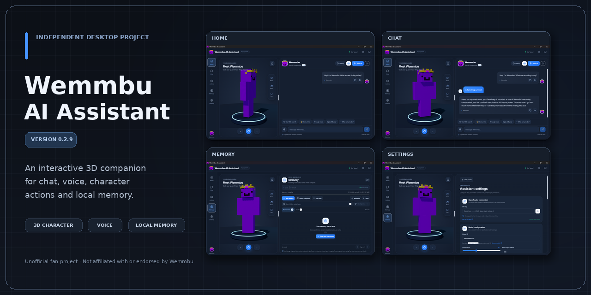
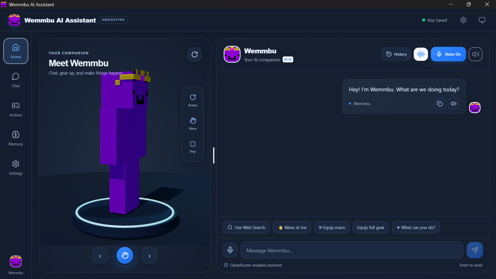
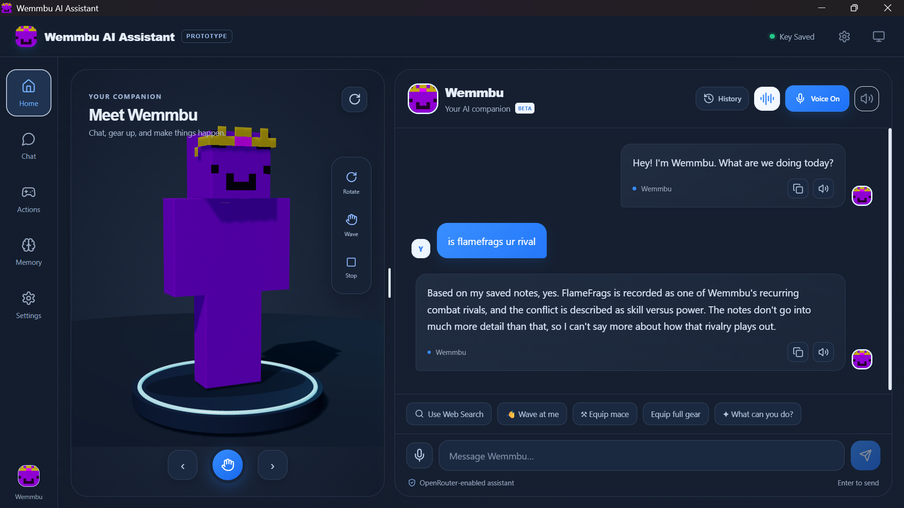
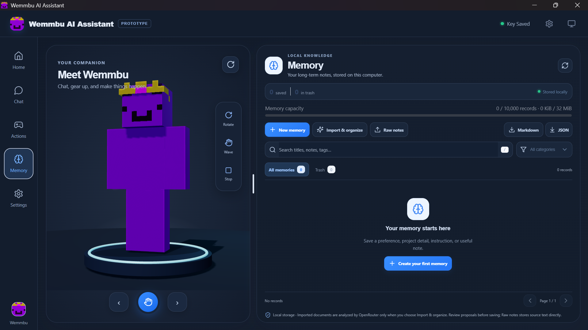
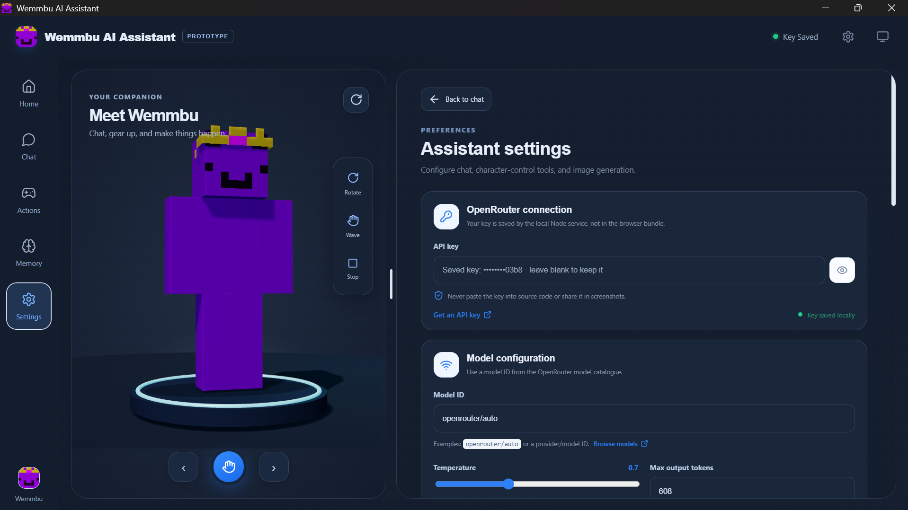

<div align="center">
  

  <h1>Wemmbu AI Assistant</h1>

  <p>A Windows desktop AI companion featuring an interactive 3D character, AI chat, voice, character actions, equipment and persistent local memory.</p>

  <p>
    <a href="LICENSE"></a>
    <a href="CONTRIBUTING.md"></a>
    <a href="SECURITY.md"></a>
  </p>
  <p>
    
    
    
    
    
    
  </p>
</div>

> **Unofficial fan project.** This is an independently developed project. It is not affiliated with, endorsed by, sponsored by, or operated by Wemmbu, the Unstable SMP, Mojang Studios or Microsoft. It does not represent or speak for the person whose character is depicted.

## Screenshots

The screenshots below show the application's current interface. Select any image to view it at full resolution.

<table>
  <tr>
    <td width="50%">
      <a href="docs/media/home.png"></a>
      <p align="center"><strong>Home</strong><br>Interactive character stage and companion workspace</p>
    </td>
    <td width="50%">
      <a href="docs/media/chat.png"></a>
      <p align="center"><strong>Chat</strong><br>AI conversations, voice and character interaction</p>
    </td>
  </tr>
  <tr>
    <td width="50%">
      <a href="docs/media/memory.png"></a>
      <p align="center"><strong>Memory</strong><br>Manage and search locally stored memories</p>
    </td>
    <td width="50%">
      <a href="docs/media/settings.png"></a>
      <p align="center"><strong>Settings</strong><br>Configure AI providers, models and application preferences</p>
    </td>
  </tr>
</table>

<details>
  <summary><strong>Table of contents</strong></summary>

  - [Overview](#overview)
  - [Project status](#project-status)
  - [Features](#features)
    - [3D character and actions](#3d-character-and-actions)
    - [AI chat and integrations](#ai-chat-and-integrations)
    - [Voice](#voice)
    - [Persistent memory](#persistent-memory)
  - [Architecture](#architecture)
  - [Repository layout](#repository-layout)
  - [Development setup (Windows)](#development-setup-windows)
  - [Build and test](#build-and-test)
  - [Build the native Tauri window and Windows installer](#build-the-native-tauri-window-and-windows-installer)
  - [Provider configuration](#provider-configuration)
  - [Local data and privacy](#local-data-and-privacy)
  - [Licence](#licence)
  - [Contributing](#contributing)
  - [Related documentation](#related-documentation)
</details>

## Overview

Wemmbu AI Assistant is a Windows desktop AI companion built with **React, Three.js, Node.js and Tauri 2**. It combines an animated 3D character with AI chat, voice output, character actions, equipment interactions, image generation and persistent local memory.

The application is designed as a desktop experience: the React interface runs inside the Tauri window, while a local Node.js service handles provider integrations, application data and memory.

## Project status

| Item | Current implementation |
|---|---|
| Application version | `0.2.9` |
| Frontend | React 18 + Vite |
| 3D scene | Three.js + GLTFLoader |
| Local backend | Node.js HTTP API |
| Desktop host | Tauri 2 + Rust |
| Windows web runtime | WebView2 |
| Required Node.js for development/build | `24.15.0` or newer |

The repository includes separate GitHub Actions workflows for Windows, Linux and macOS packaging. Windows uses the tested NSIS installer workflow; Linux and macOS installers are newly added CI targets and must complete their first hosted builds and platform-specific smoke tests before being treated as validated releases. A local development run, a frontend production build and a packaged desktop installer are separate checks.

## Features

### 3D character and actions

- Renders the character and equipment models in a Three.js scene.
- Supports character rotation and camera elevation controls.
- Includes gestures such as Wave, Explain, Nod/Agree, Shake Head, Think, Point, Present, Shrug, Cheer, Salute, Facepalm and Stop/Wait.
- Uses a shared action registry for UI actions, local parsing and AI tool definitions.
- Supports armor overlays and held equipment, including a mace and Totem of Undying.

### AI chat and integrations

- Sends chat requests through the local Node API to OpenRouter.
- Exposes character-action and equipment controls to the assistant through local tools.
- Stores chat sessions locally.
- Supports optional web-search and image-generation flows where the configured provider and selected model support them.

### Voice

- Integrates Fish Audio text-to-speech.
- Provides browser/system speech fallback where available.
- Queues speech in chunks and supports interruption.
- Drives mouth animation from audio playback activity.
- Uses browser speech recognition when supported by the environment.

Fish Audio requires an API key and a voice/reference ID that you are permitted to use. The application does not ship with a creator-specific reference ID preconfigured.

### Persistent memory

- Creates, searches, updates, archives, restores and deletes local memories.
- Uses SQLite-backed storage with migration, validation and backup support.
- Makes relevant memory available to chat through memory tools.

## Architecture

The desktop app is **not** an Electron application. Tauri creates the native application window and hosts the React interface in WebView2. A local Node process provides the application API.

```text
Windows desktop window
└── Tauri 2 host (Rust: src-tauri/)
    ├── WebView2
    │   └── React + Vite frontend (src/ and public/)
    │       └── Three.js character scene and GLB assets
    └── Managed Node.js child process
        └── Local HTTP API (server/index.js)
            ├── OpenRouter chat
            ├── Fish Audio speech
            ├── Google AI Studio image generation
            ├── Settings and chat sessions
            └── SQLite-backed memory
```

The frontend calls the API at `127.0.0.1:8787`. The API binds to loopback rather than acting as a public network server. In a packaged Windows build, Tauri starts a bundled Node.js runtime and the staged API files. Settings, chat sessions and memory are stored in the operating-system application-data directory. In a development run, project data is stored under `data/` by default.

More detail: [Architecture overview](docs/ARCHITECTURE.md).

## Repository layout

```text
wemmbu-ai-assistant/
├── .github/
│   └── workflows/
│       ├── windows-tauri-installer.yml   # Windows NSIS installer workflow
│       ├── linux-tauri-installers.yml    # Linux DEB and AppImage workflows
│       └── macos-tauri-installers.yml    # macOS Apple Silicon and Intel DMGs
├── data/                                 # Local development data; not committed
├── docs/
│   ├── media/
│   │   ├── github-social-preview.png     # README hero and GitHub social preview
│   │   ├── home.png                      # Home screenshot
│   │   ├── chat.png                      # Chat screenshot
│   │   ├── memory.png                    # Memory screenshot
│   │   └── settings.png                  # Settings screenshot
│   ├── ARCHITECTURE.md                   # Runtime and component boundaries
│   ├── CONFIGURATION.md                  # Provider setup and local data
│   ├── CROSS_PLATFORM_BUILDS.md          # Linux/macOS CI builds and packaging notes
│   ├── FUNDING.md                        # Funding setup notes
│   ├── INSTALLATION.md                   # Development and Tauri build guide
│   ├── LAUNCH.md                         # Community launch notes
│   ├── ROADMAP.md                        # Planned work
│   ├── TESTING.md                        # Test and release commands
│   ├── THIRD_PARTY_AND_RELEASE_RIGHTS.md # Asset/licence notes
│   └── development-history/              # Earlier implementation notes
├── public/
│   ├── assets/                           # Static images and public assets
│   └── models/                           # Character, armour and item models/textures
├── scripts/                              # Build preparation, asset checks and diagnostics
├── server/
│   ├── index.js                          # Local HTTP API and provider routes
│   ├── httpCors.js                       # Local-origin/CORS checks
│   ├── memoryEngine.js                   # Memory import/organise logic
│   ├── memorySqliteStore.js              # SQLite memory persistence
│   ├── memoryStore.js                    # Memory storage utilities and compatibility
│   ├── memoryTools.js                     # Chat memory tools/context
│   └── *.test.js                         # Backend and integration tests
├── shared/
│   ├── characterActions.js               # Shared action/gesture registry
│   └── characterAnimation.js             # Shared animation definitions
├── src/
│   ├── App.jsx                           # Main React application and navigation
│   ├── CharacterStage.jsx                # Three.js character stage
│   ├── MarkdownMessage.jsx               # Chat message rendering
│   ├── MemoryPanel.jsx                   # Memory interface
│   ├── SettingsPanel.jsx                 # Provider and application settings
│   ├── api.js                             # Frontend API client
│   ├── speechAudioController.js          # Speech playback/audio integration
│   └── speechPlaybackQueue.js             # Speech chunk queue and playback
├── src-tauri/
│   ├── capabilities/                     # Tauri v2 permissions
│   ├── gen/schemas/                      # Generated Tauri schemas
│   ├── icons/                            # Windows, macOS and Linux application icons
│   ├── src/main.rs                       # Native app entry point and API process host
│   ├── Cargo.toml                        # Rust/Tauri dependencies and release profile
│   └── tauri.conf.json                   # Window, dev URL, frontend and bundle settings
├── verification/                         # Character/model fit reference images
├── CONTRIBUTING.md
├── LICENSE                              # GNU GPL v3.0
├── SECURITY.md
├── THIRD_PARTY_ASSETS.md
├── README-TAURI-INSTALLER.md
├── package.json                         # npm scripts and dependency definitions
├── package-lock.json
├── vite.config.js
└── start.bat                             # Windows development launcher
```

The tree shows the main areas, not every test, generated schema or asset file. Keep runtime data (credentials, sessions, databases and backups) out of commits.

## Development setup (Windows)

### Requirements

- Windows 10 or 11, x64.
- Git.
- Node.js `24.15.0` or newer, with npm.
- WebView2 Runtime for the Tauri desktop shell. The Windows installer is configured to use the WebView2 bootstrapper for end-user installation.

Rust, Visual Studio C++ Build Tools, NSIS and the Tauri CLI are needed only when building or running the native Tauri desktop application. See [Building the Windows desktop app](docs/INSTALLATION.md).

### Clone and install

Open PowerShell and run:

```powershell
git clone https://github.com/opendeveloper-ai/wemmbu-ai-assistant.git
cd wemmbu-ai-assistant
node --version
npm --version
npm ci
```

The Node.js version must satisfy the `engines` entry in `package.json` (`>=24.15.0`).

### Run the browser development app

```powershell
npm run dev
```

This starts both services:

- Vite frontend: [http://127.0.0.1:1420](http://127.0.0.1:1420)
- Local Node API: `http://127.0.0.1:8787`

Leave the terminal running while using the app. Open the Vite address in a browser. You can also run `start.bat` from PowerShell or File Explorer on Windows; it checks Node.js, installs dependencies when needed and starts the development services.

Open **Settings** in the app to configure provider keys and model options. See [Provider configuration](docs/CONFIGURATION.md).

## Build and test

Run these from the repository root:

```powershell
# Production frontend build, including character asset verification
npm run build

# Full automated test suite
npm run test:all

# Tests plus the production frontend build
npm run verify:release
```

Useful focused checks:

```powershell
npm run test:memory
npm run test:desktop
npm run test:assets
npm run test:voice
npm run check:build-chunks
```

The script definitions in `package.json` are the source of truth for available commands. See [Testing](docs/TESTING.md).

## Build the native Tauri window and Windows installer

The native window is created by Tauri, not by a separate React window component:

- `src-tauri/tauri.conf.json` defines the `main` window, title, initial size (`1440 × 920`), minimum size (`1024 × 700`) and resize behaviour.
- In development, Tauri starts Vite at `http://127.0.0.1:1420` using `devUrl` and `beforeDevCommand`.
- In a production build, Tauri loads the Vite output from `dist/` (`frontendDist`).
- `src-tauri/src/main.rs` starts the local Node API as a managed child process, waits for its health endpoint and stops it when the desktop app exits.
- `scripts/prepare-tauri-resources.mjs` stages the API source and the native Node.js runtime under `src-tauri/resources/` for the matching build OS (Windows, Linux or macOS).

For a native Tauri development window, install the desktop build prerequisites and run:

```powershell
npm ci
npm run tauri:dev
```

For a Windows NSIS installer, install the Windows build prerequisites and run:

```powershell
npm ci
npm run test:all
npm run tauri:build:windows
```

The installer is written to:

```text
src-tauri/target/release/bundle/nsis/*-setup.exe
```

The installed app includes the Node runtime used by its local API, so end users do not need to install Node.js separately. The WebView2 bootstrapper is configured in the Tauri bundle settings. The installer is currently unsigned unless a code-signing setup is added.

The Windows NSIS wizard uses custom Wemmbu-branded header/sidebar artwork; the GPL-3.0 licence file is included in the platform bundles. Linux packages use the generated application icons, and the macOS DMG uses a custom branded background. See [cross-platform build and installer branding notes](docs/CROSS_PLATFORM_BUILDS.md).

The complete Windows prerequisites and troubleshooting steps are in [docs/INSTALLATION.md](docs/INSTALLATION.md) and [README-TAURI-INSTALLER.md](README-TAURI-INSTALLER.md). The Linux/macOS hosted build targets, artifact names and macOS signing caveat are documented in [docs/CROSS_PLATFORM_BUILDS.md](docs/CROSS_PLATFORM_BUILDS.md).

## Provider configuration

Provider credentials are entered in the application's **Settings** panel and stored by the local Node service.

| Integration | Used for | Required configuration |
|---|---|---|
| OpenRouter | AI chat | API key and model ID |
| Fish Audio | Text-to-speech | API key and permitted voice/reference ID |
| Google AI Studio | Image generation | API key |

Provider use may consume quota or incur charges. Review the provider's current pricing and terms. Chat prompts, speech text or image prompts are sent to the selected provider when those features are used; this application is not an offline-only AI client.

See [docs/CONFIGURATION.md](docs/CONFIGURATION.md) for setup and data-storage details.

## Local data and privacy

- In development, the API uses `data/` by default. Tauri sets the data directory to the operating-system application-data location.
- Provider credentials, chat sessions, generated images and memory are local application data; they are not source files.
- The API listens on `127.0.0.1:8787`. It is intended for the local desktop app, not as a remotely accessible multi-user service.
- Requests sent to OpenRouter, Fish Audio or Google AI Studio leave the computer and are subject to the provider's policies.
- Do not commit `data/settings.json`, session exports, memory databases, memory backups, `.env` files, API keys or private logs.

Read [SECURITY.md](SECURITY.md) before reporting a security issue.

## Licence

The original project code is distributed under the **GNU General Public License, version 3.0**. See [`LICENSE`](LICENSE) for the complete terms.

Third-party models, textures, images, libraries and other included materials may have their own licences and attribution requirements. The GPL licence for the project code does not replace or override the terms attached to those materials. Refer to [`THIRD_PARTY_ASSETS.md`](THIRD_PARTY_ASSETS.md) and preserve the applicable notices when using or redistributing them.

## Contributing

Bug reports, focused fixes, tests and documentation improvements are welcome. Read [CONTRIBUTING.md](CONTRIBUTING.md) before opening a pull request.

## Related documentation
- [Cross-platform desktop build workflows](docs/CROSS_PLATFORM_BUILDS.md)

- [Installation and Windows desktop build](docs/INSTALLATION.md)
- [Architecture overview](docs/ARCHITECTURE.md)
- [Provider configuration](docs/CONFIGURATION.md)
- [Testing and release checks](docs/TESTING.md)
- [Third-party assets](THIRD_PARTY_ASSETS.md)
- [Roadmap](docs/ROADMAP.md)
- [Community launch notes](docs/LAUNCH.md)
- [Tauri installer notes](README-TAURI-INSTALLER.md)

---

<div align="center">
  <sub>Built independently. Not affiliated with or endorsed by the creators or rights holders referenced above.</sub>
</div>
