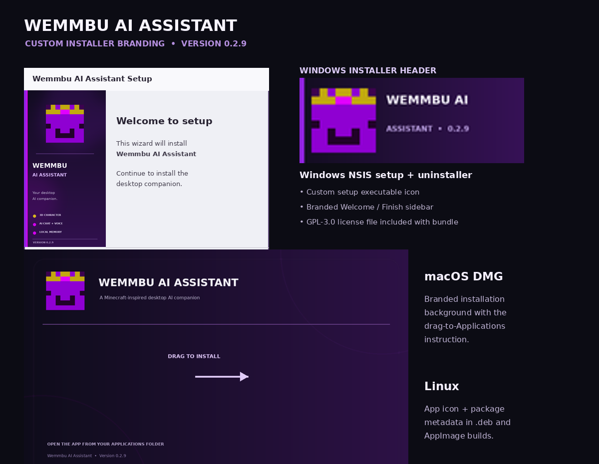

# Cross-platform desktop build workflows

The repository builds native installers on GitHub-hosted runners. A Windows development PC is sufficient to trigger and download the Linux/macOS build artifacts.

## Workflows

- `.github/workflows/windows-tauri-installer.yml`: Windows x64 NSIS `.exe`.
- `.github/workflows/linux-tauri-installers.yml`: Linux x64 `.deb` and `.AppImage`.
- `.github/workflows/macos-tauri-installers.yml`: macOS Apple Silicon (`arm64`) and Intel (`x64`) `.dmg` installers.

All three workflows can be started manually from **GitHub → Actions**, or automatically when a new `v*` tag is pushed. They upload build outputs as workflow artifacts with 30-day retention. Download those artifacts from the completed workflow run, inspect/test them, then attach the appropriate files to the GitHub Release.

## Runtime packaging

The Tauri app bundles the Node.js runtime used by its local API. Each platform build script first generates the Tauri icon set from `src-tauri/icons/icon.png`. The resource staging script then copies the native executable from the matching CI runner:

- Windows: `resources/runtime/node.exe`
- Linux/macOS: `resources/runtime/node`

The Rust desktop launcher selects the matching filename for the build target. Development mode continues to use `node` from the developer environment and does not require a bundled runtime.

Node.js 24.15.0 or newer is required. The workflow runners use Node.js 24.15.0.

## Linux prerequisites and output

The Linux workflow builds on Ubuntu 22.04 with Tauri's GTK/WebKit development dependencies. It creates:

- `.deb` for Debian/Ubuntu-based distributions.
- `.AppImage` as a portable package for compatible Linux distributions.

The AppImage build enables Tauri's media-framework bundling because the application plays generated speech/audio. The AppImage still has a glibc compatibility floor; Ubuntu 22.04 is used as a conservative build baseline. Test the generated files on the Linux distributions you intend to support.

## macOS output and signing

The macOS workflow builds two separate native DMGs:

- Apple Silicon: `arm64` (`macos-26` runner).
- Intel: `x64` (`macos-26-intel` runner).

These builds are not code-signed or notarized because no Apple Developer signing credentials are configured in the workflow. macOS may warn users when opening an unsigned download. For a public consumer release, configure Developer ID signing and notarization before describing the DMGs as Gatekeeper-ready.

## Installer branding

All platform builds use the shared square pixel-art Wemmbu avatar in `src-tauri/icons/icon.png`. Each workflow regenerates the native icon formats with `cargo tauri icon` before bundling. The matching frontend avatar is stored at `public/assets/wemmbu_logo.png`.

- **Windows NSIS:** branded setup/uninstaller executable icons, wizard header and Welcome/Finish sidebar artwork are configured. The GPL-3.0 license file is included in the platform bundles in `src-tauri/tauri.conf.json`. The header and sidebar BMPs are in `src-tauri/installer/`.
- **Linux:** `.deb` and `.AppImage` packages use the generated Tauri PNG application icons and package metadata. Linux package managers generally provide their own installation UI, so the application cannot control a third-party package manager's wizard design.
- **macOS:** the `.app` bundle uses the generated ICNS app icon. The DMG has a custom branded background with a drag-to-Applications instruction. Tauri notes that Finder icon placement can be inconsistent on CI-built DMGs, so verify the resulting DMG on a Mac before release.

The original Library file named `Wemmbu.png` is a full application screenshot, not a square logo; it is not used as the executable icon. A separate `wemmby.png` file was not present in the project or Library when these assets were prepared.

## Important release note

Build artifacts are not automatically attached to GitHub Releases. Download each artifact from its Actions run and manually upload the `.exe`, `.deb`, `.AppImage`, and `.dmg` files to the matching GitHub Release. The source ZIP and TAR.GZ are generated automatically by GitHub.
